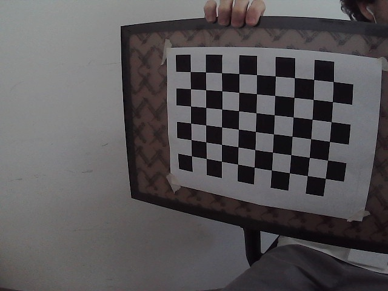
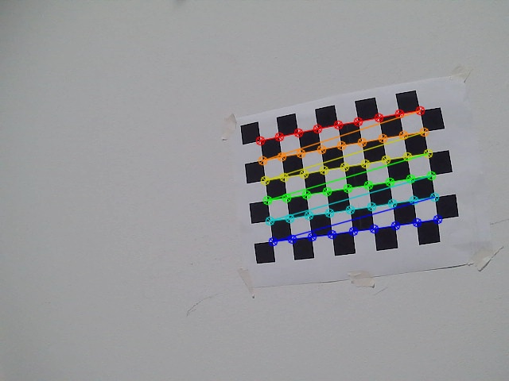
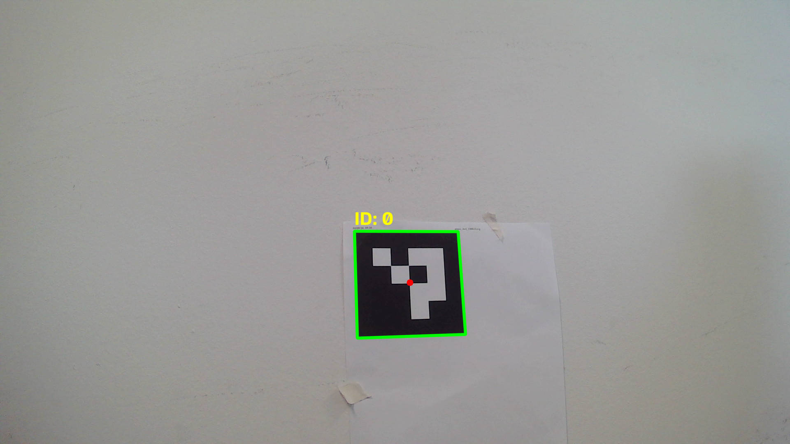
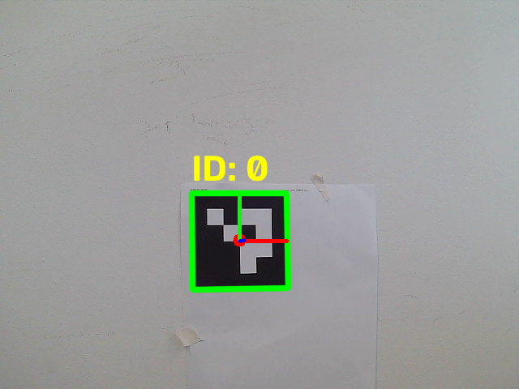

# Precision Landing

## Camera Calibration

In order to get the accurate distance and projection of a 3D point using a camera we need first to calibrate the camera. The process returns a Reprojection Error which is a measure of how well the calibration process has worked. A lower reprojection error indicates a better calibration. A value of less than 0.5 is generally considered good, but this can vary depending on the specific application and requirements. The calibration process also returns the camera matrix and distortion coefficients which are used in the pose estimation process.
After calibration, the camera matrix and distortion coefficients are saved to a file (camera_calibration.npz) which is then used in the pose estimation process. The calibration process can be run by executing the calibration.py script with the argument true or false to indicate whether to capture new calibration images or not. The script will capture images of a chessboard pattern and use them to calibrate the camera.

```bash 
python calibration.py true "output_file.npz"  # Capture new images and save calibration parameters to output_file.npz
```
```bash 
python calibration.py false "output_file.npz" # Use existing images to calibrate and save calibration parameters to output_file.npz
```

***Note***: If no output file is specified, the calibration parameters will be saved to camera_calibration.npz by default.

***Note***: The calibration process requires a chessboard pattern to be printed and used for capturing images. The chessboard pattern should have a known number of inner corners (e.g., 9x6) and the size of each square should be known (e.g., 0.025 meters). 

The process should generate a set of calibration images like the following ones:
<div style="display: flex; gap: 10px;">
  
  
</div>


# Marker Detection

our goal is to detect ArUco markers in the video stream and estimate their pose relative to the camera. The pose estimation process uses the camera matrix and distortion coefficients obtained from the calibration process to accurately determine the position and orientation of the detected markers in 3D space. The estimated pose can be used for various applications, such as augmented reality, robotics, and precision landing.

First we need a marker. We can genrate one online at [https://chev.me/arucogen/](https://chev.me/arucogen/) or we can use the one provided in the repository. The marker is a 4x4 ArUco marker with ID 0. The marker should be printed and placed (on a flat surface) in the environment where the camera will be used for detection.

***Note***: Always keep track of the size of the marker. The size of the marker is used in the pose estimation process to accurately determine the distance from the camera to the marker.if need check with a ruler the size of the marker measuring the length of the black square's side.

To try the marker detection run the detect_aruco.py script. The script will open a video stream from the camera and detect the ArUco marker in real-time. The detected marker will be highlighted with a bounding box and its ID will be displayed on the screen.

```bash
python detect_aruco.py [<AURCO_DICT_TYPE>] # Optional argument to specify the ArUco dictionary type (default: DICT_4X4_100)
```

in utils.py you can find a list of all the available ArUco dictionary types. The default dictionary type is DICT_4X4_100 which is the one used to generate the marker provided in the repository. 
The file also contains a function to display the detected markers in the video stream in a more accessible and readble way.

Example of the output of the detect_aruco.py script:



## Pose Estimation

To estimate the pose of the detected ArUco marker, we can use the pose_estimation.py script. The script will open a video stream from the camera and detect the ArUco marker in real-time. The estimated pose of the marker will be displayed on the screen along with the distance from the camera to the marker.

```bash
python pose_estimation.py -t [<AURCO_DICT_TYPE>] -c [<CALIBRATION_FILE>] -s [<MARKER_SIZE>]
```

where:
- `<AURCO_DICT_TYPE>`: Optional argument to specify the ArUco dictionary type (default: DICT_4X4_100)
- `<CALIBRATION_FILE>`: Optional argument to specify the calibration file (default: camera_calibration.npz)
- `<MARKER_SIZE>`: Optional argument to specify the size of the marker in meters (default: 0.1)

You should obtain something like this:

