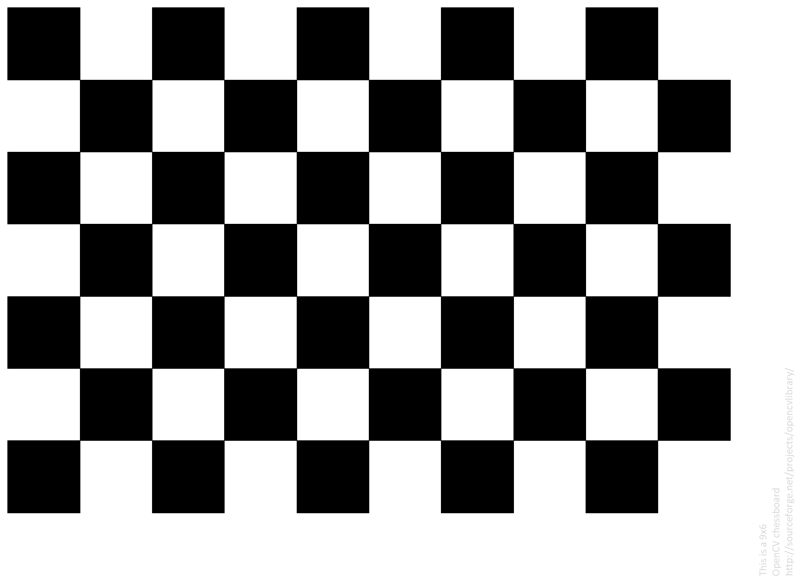
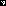
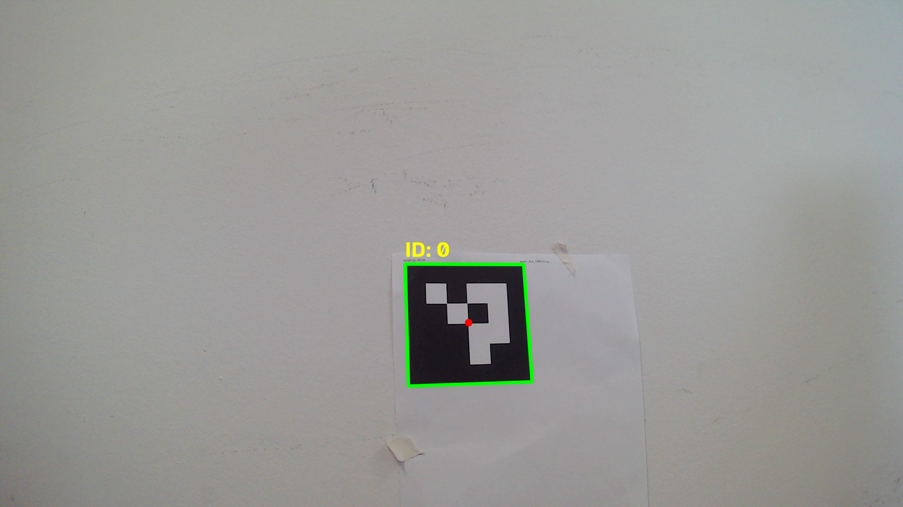
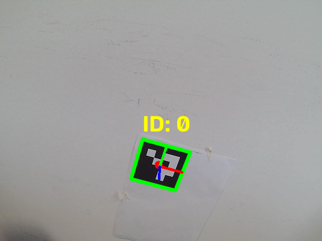

# ArUco Precision Landing

Camera calibration and ArUco marker pose estimation for precision-landing
experiments. The project includes a Gazebo camera source and can send detected
marker positions to a flight controller over MAVLink using `LANDING_TARGET`.
It does not start a landing mission or configure the flight controller's
precision-landing behavior.

## Features

- Calibrate camera intrinsics and distortion using chessboard images.
- Detect ArUco markers and estimate their pose relative to the camera.
- Read camera frames from a Gazebo image topic.
- Send marker estimates and log telemetry over MAVLink.

## Requirements

- Python
- A printed chessboard and ArUco marker for camera calibration and testing
- PX4 and Gazebo for simulation; see the [PX4 documentation](https://docs.px4.io/)
- Gazebo Python transport bindings for the installed Gazebo version
- MAVLink Router and a configured flight-controller connection for MAVLink use

Create and activate a virtual environment, then install the Python packages:

```bash
python -m venv .venv
```

```bash
# Windows PowerShell
.\.venv\Scripts\Activate.ps1

# Linux/macOS
source .venv/bin/activate
```

```bash
python -m pip install -r requirements.txt
```

Gazebo's `gz.transport` and `gz.msgs` Python bindings are supplied by the
Gazebo installation and are not installed by `pip`. On macOS with Homebrew,
locate the binding directories for the installed `gz-transport` and `gz-msgs`
versions, then add those directories to the virtual environment's
`site-packages/gz_bindings.pth` file (one absolute path per line). Find the
active environment's site-packages directory with:

```bash
python -c "import site; print(site.getsitepackages()[0])"
```

Check that both bindings are importable before running the application:

```bash
python -c "from gz.transport import Node; from gz.msgs.image_pb2 import Image"
```

## Camera calibration

Capture chessboard images with a connected camera:

```bash
python calibration.py true
```

Or calibrate using images already in `calibration_images/`:

```bash
python calibration.py false
```

Calibration parameters are saved to `camera_calibration.npz` by default. Pass
an optional output path as the second argument to select a different location.
The calibration script uses a 9-by-6 inner-corner chessboard and assumes each
square is 0.025 meters. Use calibration parameters matching the camera that
will provide the frames, including the simulated camera in Gazebo.

## Detect and estimate pose

Run live ArUco detection:

```bash
python detect_aruco.py --type DICT_4X4_1000
```

Estimate marker pose using a calibration file:

```bash
python pose_estimation.py --type DICT_4X4_1000 --calibration_params camera_calibration.npz --side_length 0.1
```

`--side_length` is the black marker's side length in meters; measure the
printed marker rather than including its white margin. Press `q` to exit.
Press the space bar to save a pose-estimation frame in the project directory.

## Images and marker

Sample images and the printable marker are in [`imgs/`](imgs/):





Example marker-detection output:



Example pose-estimation output:




Sample calibration inputs and detected-corner outputs are available in
[`calibration_images/`](calibration_images/) and
[`calibration_debug/`](calibration_debug/). New captures and debug output are
generated locally.

## Gazebo simulation

Start a PX4 Gazebo simulation with the down-facing camera and ArUco marker:

```bash
make px4_sitl gz_x500_mono_cam_down_aruco
```

In Gazebo, open the Image Display panel to confirm the camera is publishing to
the configured topic. The sample topic in `config.yaml` is:

```yaml
CAMERA_TOPIC: "/world/aruco/model/x500_mono_cam_down_0/link/camera_link/sensor/camera/image"
```

Ensure `CALIBRATION_PARAMS` points to calibration parameters matching the
simulated camera, and that `SIDE_LENGTH` and `EXPECTED_MARKER_ID` match the
marker in the scene. The supplied marker image is ID 0.

On macOS, if Gazebo transport multicast discovery is not available on loopback,
add a route for the multicast range:

```bash
sudo route add -net 224.0.0.0/4 -interface lo0
```

Set the Gazebo network address and start the application from the activated
Python environment:

```bash
export GZ_IP=127.0.0.1
python send_pose_estimation.py
```

## MAVLink Router

The application uses `MAVLINK_CONNECTION_STRING` in `config.yaml` to connect
to MAVLink Router. Configure the router's flight-controller input and an
output endpoint matching that setting. The sample setting is
`udpin:127.0.0.1:14540`.

On Debian- or Ubuntu-based companion computers, install MAVLink Router with:

```bash
sudo apt update
sudo apt install mavlink-router
```

Configure endpoints in `/etc/mavlink-router/main.conf`, following the
[MAVLink Router documentation](https://github.com/mavlink-router/mavlink-router).
Start the router and run `send_pose_estimation.py` as shown above.

Verify that the flight controller receives valid estimates and configure its
precision-landing parameters and mission separately, using documentation for
the flight-controller version. Test in a safe environment and follow the
vehicle manufacturer's safety procedures.

## Logging

For details on MAVLink runtime logs, CSV fields, and saved debug frames, see
[`LOGGING.md`](LOGGING.md). Runtime logs and generated benchmark data are
written under `logs/` and `benchmark/` and are excluded from version control.
