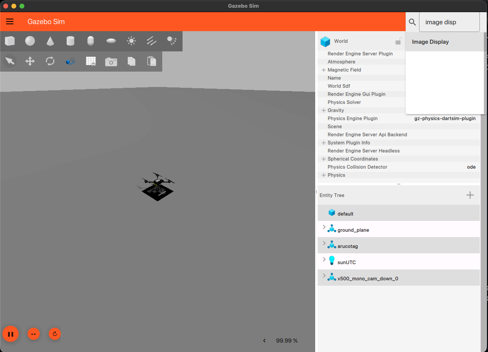

# Precision Landing

## Camera Calibration

In order to get the accurate distance and projection of a 3D point using a camera we need first to calibrate the camera. The process returns a Reprojection Error which is a measure of how well the calibration process has worked. A lower reprojection error indicates a better calibration. A value of less than 0.5 is generally considered good, but this can vary depending on the specific application and requirements. The calibration process also returns the camera matrix and distortion coefficients which are used in the pose estimation process.
After calibration, the camera matrix and distortion coefficients are saved to a file (camera_calibration.npz) which is then used in the pose estimation process. The calibration process can be run by executing the calibration.py script with the argument true or false to indicate whether to capture new calibration images or not. The script will capture images of a chessboard pattern and use them to calibrate the camera.

```bash 
python calibration.py true "output_file.npz"  # Capture new images and save calibration parameters to output_file.npz
```
```bash 
python calibration.py false "output_file.npz" # Use existing images to calibrate and save calibration parameters to output_file.npz
```

***Note***: If no output file is specified, the calibration parameters will be saved to camera_calibration.npz by default.

***Note***: The calibration process requires a chessboard pattern to be printed and used for capturing images. The chessboard pattern should have a known number of inner corners (e.g., 9x6) and the size of each square should be known (e.g., 0.025 meters). 

The process should generate a set of calibration images like the following ones:
<div style="display: flex; gap: 10px;">
  
  
</div>


# Marker Detection

our goal is to detect ArUco markers in the video stream and estimate their pose relative to the camera. The pose estimation process uses the camera matrix and distortion coefficients obtained from the calibration process to accurately determine the position and orientation of the detected markers in 3D space. The estimated pose can be used for various applications, such as augmented reality, robotics, and precision landing.

First we need a marker. We can genrate one online at [https://chev.me/arucogen/](https://chev.me/arucogen/) or we can use the one provided in the repository. The marker is a 4x4 ArUco marker with ID 0. The marker should be printed and placed (on a flat surface) in the environment where the camera will be used for detection.

***Note***: Always keep track of the size of the marker. The size of the marker is used in the pose estimation process to accurately determine the distance from the camera to the marker.if need check with a ruler the size of the marker measuring the length of the black square's side.

To try the marker detection run the detect_aruco.py script. The script will open a video stream from the camera and detect the ArUco marker in real-time. The detected marker will be highlighted with a bounding box and its ID will be displayed on the screen.

```bash
python detect_aruco.py [<AURCO_DICT_TYPE>] # Optional argument to specify the ArUco dictionary type (default: DICT_4X4_100)
```

in utils.py you can find a list of all the available ArUco dictionary types. The default dictionary type is DICT_4X4_100 which is the one used to generate the marker provided in the repository. 
The file also contains a function to display the detected markers in the video stream in a more accessible and readble way.

Example of the output of the detect_aruco.py script:


## Pose Estimation

To estimate the pose of the detected ArUco marker, we can use the pose_estimation.py script. The script will open a video stream from the camera and detect the ArUco marker in real-time. The estimated pose of the marker will be displayed on the screen along with the distance from the camera to the marker.

```bash
python pose_estimation.py -t [<AURCO_DICT_TYPE>] -c [<CALIBRATION_FILE>] -s [<MARKER_SIZE>]
```

where:
- `<AURCO_DICT_TYPE>`: Optional argument to specify the ArUco dictionary type (default: DICT_4X4_100)
- `<CALIBRATION_FILE>`: Optional argument to specify the calibration file (default: camera_calibration.npz)
- `<MARKER_SIZE>`: Optional argument to specify the size of the marker in meters (default: 0.1)

You should obtain something like this:


## Runing on raspberry + OrangeCube

- set up /etc/mavlink-router/main.conf
- on a terminal run 
```bash
sudo mavlink-routerd -c /etc/mavlink-router/main.conf 
```

- run 
```bash
 source ~/drone/drone_env/bin/activate
 python send_pose_estimation.py 
 ```

## Simulating the precision landing in Gazebo

### Environment Setup and Dependencies

Ensure that you have the following dependencies installed on your system: pymavlink, opencv, protobuf, pyyaml and numpy. You can install them using pip:

```bash
pip install pymavlink opencv-python pyyaml numpy protobuf
```
[For MacOS] Since we wamt to use Gazebo-transport binding to subscribe to the camera topic, we need to add the binding to the PYTHONPATH. The binding is located in the Gazebo installation directory. You can add the binding to the PYTHONPATH by running the following command:

### Gazebo Python Transport & Bindings Setup (`gz-transport`)

#### Why this is required
The landing target script reads images directly from the Gazebo simulation engine using `gz.transport` and `gz.msgs.image_pb2`.

Unlike standard Python libraries, **`gz-transport` cannot be installed via `pip install`** (PyPI does not host pre-compiled wheels for macOS or newer Gazebo versions). Instead, the bindings are compiled as native C++ shared libraries during the Homebrew installation of Gazebo / PX4 dependencies.

Because Python virtual environments (`venv`) isolate themselves from system libraries by default, running `from gz.transport import Node` will result in `ModuleNotFoundError: No module named 'gz'`. We bridge this gap by adding a `.pth` path-configuration file directly inside the virtual environment.

### Check Your Virtual Environment Python Version

Check which minor version of Python your active virtual environment is using:

```bash
python --version
```

### Link the Homebrew Bindings to the Virtual Environment

Create a `.pth` file inside your virtual environment's `site-packages` directory so Python automatically adds the Homebrew paths to `sys.path`.

Run this command inside your activated `(venv)` (replace `python3.12` with your version from Step 3 if different):

```bash
python -c "import site; print(site.getsitepackages()[0])" | xargs -I {} sh -c '
echo "/opt/homebrew/opt/gz-transport15/lib/python3.12/site-packages" > {}/gz_bindings.pth
echo "/opt/homebrew/opt/gz-msgs12/lib/python3.12/site-packages" >> {}/gz_bindings.pth
'
```

*Alternatively, create a file named gz_bindings.pth directly inside your venv/lib/pythonX.X/site-packages/ directory with these two lines:*

```
/opt/homebrew/opt/gz-transport15/lib/python3.12/site-packages
/opt/homebrew/opt/gz-msgs12/lib/python3.12/site-packages
```
### Verify the Imports

Confirm that Python can import the node transport client and the image protobuf definitions without errors:

```bash
# 1. Verify gz.transport node
python -c "from gz.transport import Node; print('gz.transport loaded successfully!')"

# 2. Verify gz.msgs image parser
python -c "from gz.msgs.image_pb2 import Image as GzImage; print('gz.msgs loaded successfully!')"
```

### Network Routing Fix
On macOS, gz-transport uses UDP multicast for node discovery. By default, macOS does not route multicast packets to the loopback interface (lo0), causing gz-transport to fail with No route to host and drop all image messages.

Include this command under a macOS setup subsection:

```bash
sudo route add -net 224.0.0.0/4 -interface lo0
```

### Gazebo Simulation Environment

To simulate the precision landing in Gazebo, we need to first set up the Gazebo environment and the drone model. The Gazebo environment should include a flat surface where the ArUco marker can be placed. The drone model should be equipped with a camera that can capture images of the environment. PX4 provides a Gazebo simulation environment that can be used for testing and development. The simulation environment can be set up by following the instructions provided in the PX4 documentation.

```bash
# Start the Gazebo simulation environment with the drone model, aruco marker and down facing camera
make px4_sitl gz_x500_mono_cam_down_aruco
```

Once it starts, we need to subscribe to the camera topic. Inside the Gazebo simulation environment, select from the top right menu "Image Display". This should open a new window with the camera feed. In the "Image Display" window.



### Subscribing to the camera topic

Then on a new terminal run the following command to subscribe to the camera topic and display the camera feed in a new window:

```bash
export GZ_IP=127.0.0.1  
python send_pose_estimation.py 
```

### Configuraiton file and script changes
Inside 'config.yaml' the following parameters were added in order to make the simulation work:
```yaml
CAMERA_TOPIC: "/world/aruco/model/x500_mono_cam_down_0/link/camera_link/sensor/camera/image"
````

This parameter is used inside the 'send_pose_estimation.py' script to subscribe to the camera topic and get the camera feed. The script was modified to use this parameter instead of the default camera topic. 
